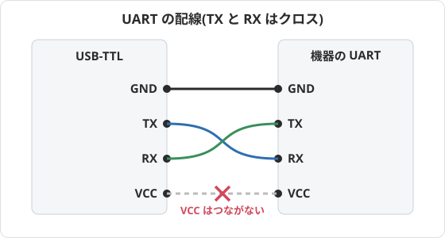
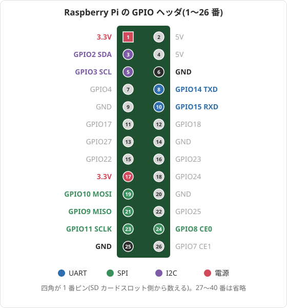
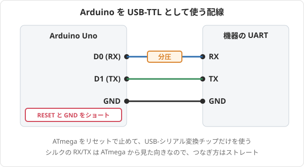
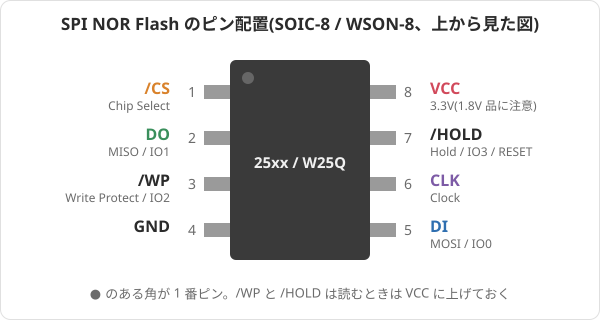
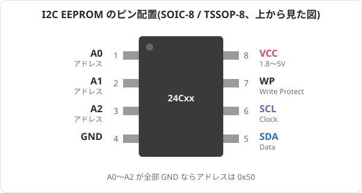

組み込み機器を解析するとき、最初にやることはだいたい同じ。**シリアルコンソールを探す**、**フラッシュの中身を吸い出す**。この2つができれば、あとはソフトの話になる。

ここではその「ソフトの話になる前」の、ハードウェア周りの手順と道具をまとめておく。

## UART

まずはシリアルコンソール。ブートローダのログが見えるだけで得られる情報量がまるで違うし、U-Boot のプロンプトに入れればメモリやフラッシュを直接読めることも多い。

### コネクタのサイズ(ピッチ)

基板上の UART は、だいたい次のどれかの形をしている。

| 形状                 | ピッチ                                   | 備考                                                                           |
| -------------------- | ---------------------------------------- | ------------------------------------------------------------------------------ |
| ピンヘッダ           | 2.54mm                                   | 一番よくある。ジャンパワイヤ(デュポン)がそのまま刺さる                         |
| ピンヘッダ           | 2.0mm                                    | 少し小さい。2.54mm のワイヤは刺さらない                                        |
| JST 系コネクタ       | 1.0mm(SH)/ 1.25mm / 1.5mm(ZH)/ 2.0mm(PH) | TV box やルーターに多い。対応するケーブルを用意するか、ピンに直接はんだ付け    |
| スルーホール(穴だけ) | 2.54mm が多い                            | ピンヘッダをはんだ付けする。急ぎならワイヤを差して斜めに押し当てるだけでも通る |
| テストパッド         | —                                        | 丸や四角の銅箔だけ。ワイヤを直接はんだ付けするか、ポゴピンで当てる             |

ピッチはノギスで測るのが確実だけど、2.54mm のピンヘッダを横に並べてみて合うかどうかでも大体分かる。

### どこにあるか

- **SoC の近く**にあることが多い。SoC の UART0 から短く引き出されている
- **4 ピン**(VCC / GND / TX / RX)か **3 ピン**(GND / TX / RX)の一列。VCC が無い 3 ピンのほうが安全でありがたい
- シルクに `TX` `RX` `GND` `VCC` と書いてあれば勝ち。`J1` `CN3` `DEBUG` `CON` みたいな名前だけのことも多い
- ピンが立っているとは限らない。**量産品はピンを省いて穴やパッドだけ**になっていることが多い
- 4 つ並んだパッドの横に小さい抵抗(TX/RX に直列の 0Ω や 100Ω くらい)が付いていることがある。逆に、抵抗が実装されていない(パッドだけ)せいで信号が来ていないこともあるので、それっぽいのに何も出ないときは周りを見る

### テスターでピンを特定する

ロジックアナライザがあれば一発だけど、テスター(マルチメータ)だけでもほぼ特定できる。

**電源を切った状態で:**

1. 導通モードで、USB コネクタの外側やシールド板など確実な GND と各ピンを当てる。鳴ったピンが **GND**

**電源を入れた状態で(DC 電圧モード、黒プローブは GND):**

2. 起動中ずっと **3.3V で一定**、電源を入れた瞬間から出ているピンが **VCC** の候補
3. **起動直後に電圧がフラフラ揺れる**ピンが **TX**(機器側の送信)。ログを吐いている間はビットが 0 と 1 を行き来するので、テスターだと 2.x V くらいで細かく振れて見える。ログが止まると 3.3V に戻る
4. 残りが **RX**(機器側の受信)。プルアップされていて 3.3V 付近で一定か、浮いていて 0V 付近のことが多い

VCC と RX が両方 3.3V 一定で区別がつかないときは、電源を切って GND との間の抵抗を測る。VCC は電源ラインなのでコンデンサの充電でじわじわ値が変わる、RX はそうならない、で大体分かる。どうしても分からなければ、RX 候補には何もつながず TX と GND だけで先にログを見ればいい。

**電圧レベルは必ず確認する。** 最近の SoC には UART が **1.8V** のものがある。3.3V の USB-TTL をそのままつなぐと SoC を壊す可能性があるので、TX の電圧が 1.8V 付近ならレベル変換を挟むか、1.8V 対応のアダプタを使う。

それから、つなぐのは **GND・TX・RX の 3 本だけ**。**VCC はつながない**。機器は自分の電源で動かす。USB-TTL の電源と機器の電源をつなぐと、どちらかが逆流で壊れることがある。TX と RX は**クロス**(こちらの TX → 機器の RX、こちらの RX → 機器の TX)。



### よくあるボーレート

| ボーレート   | よく見るところ                                                                     |
| ------------ | ---------------------------------------------------------------------------------- |
| 115200       | 圧倒的に多い。迷ったらまずこれ。Amlogic、Broadcom、Allwinner、古めの Rockchip など |
| 1500000      | 新しめの Rockchip(RK3328 / RK3399 / RK35xx など)                                   |
| 57600        | 一部の MediaTek / Ralink 系ルーター                                                |
| 38400 / 9600 | 古い機器やマイコン系                                                               |

文字化けしたらボーレート違い。115200 → 1500000 → 57600 → 38400 → 9600 の順に試せば大抵どれかで読める。ロジックアナライザやオシロがあるなら、**一番短いパルスの幅**を測って `1 / 幅` を計算すればボーレートが出る(8.68µs なら 115200)。

設定はほぼ例外なく **8N1(8bit、パリティなし、ストップビット 1)、フロー制御なし**。

```sh
picocom -b 115200 /dev/ttyUSB0
# または
screen /dev/ttyUSB0 115200
```

### 使う機器

#### CH340(USB-TTL 変換)

一番手軽で安い。数百円で買える CH340G / CH340C / CH340E の基板で十分。FT232RL や CP2102 のものでも同じように使える。

- 3.3V / 5V 切り替えのジャンパがあるものは、**必ず 3.3V 側にする**
- 1.8V の機器には使えない。1.8V 対応のアダプタか、レベル変換基板を挟む
- 1500000 baud にも対応している(CH340 は 2Mbps まで)

#### Raspberry Pi

手元にラズパイがあるなら、その GPIO の UART が使える。ラズパイ自体が Linux なので、そのまま SSH でつないでログを取れるのが便利。後の SPI / I2C で使うピンも含めて、ヘッダの配置はこうなっている。



| ラズパイのピン      | 役割 | 機器側 |
| ------------------- | ---- | ------ |
| 6 番(GND)           | GND  | GND    |
| 8 番(GPIO14 / TXD)  | 送信 | RX     |
| 10 番(GPIO15 / RXD) | 受信 | TX     |

`raspi-config` の Interface Options → Serial Port で、「ログインシェルをシリアルに出すか」を **No**、「シリアルポートを有効にするか」を **Yes** にする。Pi 3 / 4 だと標準では GPIO14/15 が mini UART(コアクロックに依存してボーレートがずれる)に割り当てられているので、`/boot/firmware/config.txt` に

```
dtoverlay=disable-bt
```

を書いて Bluetooth を止め、ちゃんとした UART(PL011)を GPIO 側に回しておくと安定する。あとは `picocom -b 115200 /dev/serial0`。

ラズパイの GPIO は 3.3V なので、3.3V の機器にはそのままつなげる。

#### ESP32

ESP32 の開発ボードには USB-シリアル変換チップ(CP2102 や CH340)が載っているので、それを経由して ESP32 の別の UART をブリッジさせればいい。スケッチはこれだけ。

```cpp
// USB 側の Serial と、機器につないだ Serial2 を素通しする
void setup() {
  Serial.begin(115200);
  Serial2.begin(115200, SERIAL_8N1, 16, 17); // RX=GPIO16, TX=GPIO17
}

void loop() {
  while (Serial2.available()) Serial.write(Serial2.read());
  while (Serial.available()) Serial2.write(Serial.read());
}
```

機器の TX を GPIO16、機器の RX を GPIO17、GND 同士をつなぐ。ボーレートは `Serial2.begin` のほうを機器に合わせ、ホスト側の picocom などは `Serial.begin` の値に合わせる(どちらも同じ値にしておけば迷わない)。ESP32 も 3.3V なのでそのままつなげる。

#### Arduino(USB-TTL として使う)

Arduino Uno のような「マイコン + USB-シリアル変換チップ」構成のボードは、**マイコンをリセット状態に固定**すると USB-シリアル変換チップだけを使える。

1. **RESET ピンと GND をジャンパワイヤでショート**する。これで ATmega328P がリセットされっぱなしになり、D0/D1 ピンがハイインピーダンスになる
2. 機器とは **ストレート**につなぐ
   - Arduino の **D0(RX と書いてある)→ 機器の RX**
   - Arduino の **D1(TX と書いてある)→ 機器の TX**
   - GND 同士

D0/D1 のシルク表記は ATmega から見た向きなので、USB-シリアル変換チップから見ると逆になる。ここで普段の「クロス」とは逆になるのが一番ハマるところ。



注意点として、**Uno は 5V ロジック**。Arduino 側から機器に向かう線(D0 → 機器の RX)には 5V が出るので、3.3V の機器には抵抗分圧(例えば 1kΩ と 2kΩ で 5V → 3.3V)を挟む。機器の TX(3.3V)→ Arduino 方向はそのままでも大抵読める。DIP の ATmega なら、リセットの代わりにチップを抜いてしまってもいい。

## SPI NOR Flash / EEPROM

ブートローダや設定、小さい機器ならファームウェア全体が入っているのが SPI NOR Flash。8 ピンの小さいチップで、型番を見れば容量が分かる。

### よくあるパッケージと容量

| パッケージ      | サイズ            | 備考                                                 |
| --------------- | ----------------- | ---------------------------------------------------- |
| SOIC-8(150mil)  | 幅 3.9mm          | 小容量(〜16Mbit)に多い                               |
| SOIC-8(208mil)  | 幅 5.3mm          | 一番よく見る。クリップで挟みやすい                   |
| WSON-8 / USON-8 | 6×5mm、8×6mm など | 足が無く、裏にパッドがあるだけ。クリップでは挟めない |
| SOIC-16(300mil) | 幅 7.5mm          | 256Mbit 以上の大容量に多い                           |

メーカーは Winbond(`W25Q`)、Macronix(`MX25L`)、GigaDevice(`GD25Q`)、XMC、EON(`EN25`)あたり。型番の数字が Mbit 単位の容量になっていることが多い(`W25Q128` = 128Mbit = 16MB)。組み込み機器では 1MB〜32MB くらいが普通。

ピン配置はどのメーカーもほぼ共通。



**電圧に注意。** 大半は 3.3V だけど、`MX25U`、`GD25LQ`、`W25Q...W` のような **1.8V 品**がある。型番でデータシートを引いて、1.8V なら 1.8V アダプタを使う。

EEPROM は設定値(MAC アドレスやシリアル番号など)が入っていることが多い。I2C の `24Cxx`(SOIC-8 / TSSOP-8)が一般的で、容量は数百バイト〜数十 KB。



### アクセス方法

#### クリップ

SOIC-8 なら **SOIC8 テストクリップ**で基板に載せたまま挟める。安いクローンでも使えるけど、バネが弱くてすぐ外れるものもある。挟んだら、必ず**ピン 1(チップの丸いくぼみ側)とクリップの赤線を合わせる**。

基板に載せたまま読む(in-circuit)ときの落とし穴:

- クリップから VCC を供給すると、同じ電源ラインにつながっている **SoC まで起動しようとして**、SPI バスを横取りしたり電流が足りなくなったりする
- 読めない・毎回値が変わるときは、SoC のリセットピンを GND に落とす、機器側の電源を入れてからクリップ側の VCC は外す、などを試す
- それでもダメなら、ホットエアーでチップを外して、ソケットや変換基板に載せて読む。これが一番確実

#### ポゴピン

WSON-8 はクリップで挟めないので、**ポゴピン(バネ付きピン)**を使う。

- 8 本のポゴピンが並んだ **WSON8 用のプローブ**(ペン型や治具型)を上から押し当てる。手で押さえ続けるのはつらいので、治具で固定できるものが楽
- チップを外せるなら、外して **WSON8 のソケット(クラムシェル型)**に入れるほうが確実
- テストパッドに出ている UART や SPI 信号に当てるときにも、ポゴピンを使ったクリップや治具が便利

### ライター機器

定番は CH341A のプログラマ(数百円〜)。flashrom にも対応していて一番楽。ただ、昔からある黒い基板の CH341A は**データ線に 5V が出る**個体があるので、3.3V のチップに使うなら改造品か、3.3V 化済みの新しい版を選ぶ。

以下は手元にあるもので済ませる方法。

#### Raspberry Pi(flashrom)

ラズパイの SPI に直接つないで、flashrom の `linux_spi` で読める。

| ラズパイのピン       | 信号 | Flash のピン             |
| -------------------- | ---- | ------------------------ |
| 17 番(3.3V)          | VCC  | 8(VCC)、3(/WP)、7(/HOLD) |
| 25 番(GND)           | GND  | 4                        |
| 24 番(GPIO8 / CE0)   | /CS  | 1                        |
| 21 番(GPIO9 / MISO)  | DO   | 2                        |
| 19 番(GPIO10 / MOSI) | DI   | 5                        |
| 23 番(GPIO11 / SCLK) | CLK  | 6                        |

/WP と /HOLD は 3.3V に上げておく(浮いていると読めないことがある)。`raspi-config` で SPI を有効にしてから:

```sh
sudo apt install flashrom

# チップの認識
flashrom -p linux_spi:dev=/dev/spidev0.0,spispeed=4000

# 読み出し。必ず 2 回読んで一致を確認する
flashrom -p linux_spi:dev=/dev/spidev0.0,spispeed=4000 -r dump1.bin
flashrom -p linux_spi:dev=/dev/spidev0.0,spispeed=4000 -r dump2.bin
sha256sum dump1.bin dump2.bin

# 書き込み(読み出したものを手元に残してから)
flashrom -p linux_spi:dev=/dev/spidev0.0,spispeed=4000 -w new.bin
```

ハッシュが一致しないときは、配線が長すぎるか、in-circuit で SoC が邪魔をしている。`spispeed` を 1000 くらいまで下げると読めることもある。

ラズパイの 3.3V ピンから流せる電流は多くないので、in-circuit で基板全体に電源が回ってしまう場合は特に不安定になる。そういうときは機器側から電源を入れて、ラズパイの 3.3V はつながない。

I2C の EEPROM は flashrom では読めないので、Linux の `at24` ドライバを使う。SDA を 3 番(GPIO2)、SCL を 5 番(GPIO3)につなぎ、`raspi-config` で I2C を有効にして:

```sh
sudo i2cdetect -y 1        # 0x50 あたりに見えるはず
echo 24c02 0x50 | sudo tee /sys/bus/i2c/devices/i2c-1/new_device
sudo cat /sys/bus/i2c/devices/1-0050/eeprom > eeprom.bin
```

`24c02` の部分はチップの型番(容量)に合わせる。

#### ESP32

ESP32 で読む方法は 2 つある。

1. **serprog として使う**: flashrom には `serprog` というシリアル経由のプログラマ用プロトコルがあって、これを実装したファームウェアをマイコンに書けば `flashrom -p serprog:dev=/dev/ttyUSB0,spispeed=4000` で普通の flashrom として使える。ESP32 向けの実装も公開されているので、探して使うのが一番楽(ちなみに Raspberry Pi Pico なら `pico-serprog` が定番で、こちらのほうが情報は多い)
2. **自分でダンプ用スケッチを書く**: 読むだけなら、SPI で `0x03`(Read Data)コマンドを送ってひたすらシリアルに流すだけなのですぐ書ける

2 のほうの最小例。VSPI のデフォルトピン(SCK=18、MISO=19、MOSI=23、CS=5)を使う。

```cpp
#include <SPI.h>

const int CS = 5;
const uint32_t SIZE = 16UL * 1024 * 1024; // チップの容量に合わせる

void setup() {
  Serial.begin(921600);
  pinMode(CS, OUTPUT);
  digitalWrite(CS, HIGH);
  SPI.begin(); // SCK=18, MISO=19, MOSI=23
  SPI.beginTransaction(SPISettings(8000000, MSBFIRST, SPI_MODE0));
  while (Serial.read() != 'r') {} // ホストから 'r' が来たら開始

  digitalWrite(CS, LOW);
  SPI.transfer(0x03);              // Read Data
  SPI.transfer(0); SPI.transfer(0); SPI.transfer(0); // アドレス 0 から
  for (uint32_t i = 0; i < SIZE; i++) Serial.write(SPI.transfer(0));
  digitalWrite(CS, HIGH);
}

void loop() {}
```

ホスト側は pyserial で受け取る。

```python
import serial
s = serial.Serial("/dev/ttyUSB0", 921600, timeout=5)
s.write(b"r")
open("dump.bin", "wb").write(s.read(16 * 1024 * 1024))
```

16MB を 921600 baud で流すと 3 分くらいかかる。シリアルは取りこぼしに気づきにくいので、これも 2 回読んでハッシュを比べる。16MB を超えるチップは 4 バイトアドレス(`0x13` コマンド)が必要になるので、そのあたりから serprog に切り替えたほうがいい。

## NAND Flash

カーネルや rootfs のような大きいデータは NAND に入っていることが多い。NOR と違って扱いが一段難しい。

### NAND の面倒なところ

- **OOB(スペア領域)がある**: 2048 バイトのページごとに 64 バイト、4096 バイトなら 224 バイトなどのスペア領域が付いている。ここに ECC やバッドブロックマーカーが入る
- **ECC は SoC 側がやる**: どのバイトに ECC を置くか、どのアルゴリズム(BCH など)を使うかは **SoC やベンダーごとにバラバラ**。チップから生で読んだデータはビットエラーを含んだままなので、レイアウトを調べて ECC を当て直さないと、そのままでは使えないことがある
- **バッドブロックがある**: 出荷時から使えないブロックがあり、SoC 側はそれを飛ばして使っている。生ダンプとファイルシステム上のオフセットがずれる原因になる
- **ファイルシステムが特殊**: UBI / UBIFS、JFFS2、YAFFS2 などの NAND 向けのものが使われる。UBI なら `ubi_reader`(`ubireader_extract_files`)で展開できる

なので NAND は、**チップから直接読む前に、ソフトウェアで読めないか先に試す**のがおすすめ。

- U-Boot のプロンプトに入れるなら `nand info` / `nand read` でメモリに読み、`md` で UART に吐かせる(遅いけど ECC 済みのデータが取れる)
- Linux のシェルに入れるなら `/proc/mtd` でパーティションを確認して、`nanddump` や `dd if=/dev/mtdX` で取る

UART の項に時間をかけたのはこのため。シリアルコンソールが取れれば NAND の吸い出しはずっと楽になる。

### よくあるパッケージ

| 種類          | パッケージ                      | 備考                                                        |
| ------------- | ------------------------------- | ----------------------------------------------------------- |
| パラレル NAND | TSOP-48(12×20mm)                | 古めの機器の定番。両側に 24 本ずつ足が出ている              |
| パラレル NAND | BGA-63 / BGA-67 など            | 大容量品や小型の機器。裏にボールがあるだけ                  |
| SPI NAND      | WSON-8(8×6mm)/ SOIC-16 / BGA-24 | 最近のルーターなどで増えている。見た目は SPI NOR とほぼ同じ |

容量は 128MB〜1GB くらいが多い。SPI NAND は Winbond `W25N`、GigaDevice `GD5F`、Macronix `MX35LF` あたり。SPI NOR と見た目が同じなので、**型番を見て NOR か NAND かを区別する**のが大事(NOR 用のツールでは読めない)。

ついでに、**eMMC**(BGA-153 / BGA-169)も中身は NAND だけど、コントローラが内蔵されていて ECC やバッドブロックを勝手に処理してくれるので、外からは普通のブロックデバイスに見える。基板上に CLK / CMD / DAT0 のテストポイントがあれば、そこから SD カードリーダーにつないで読むこともできる(ISP と呼ばれる方法)。

### アクセス方法

- **SPI NAND(WSON-8 / SOIC-16)**: SPI NOR と同じく、クリップやポゴピンで当てられる
- **TSOP-48**: クリップも売っているけど、48 本を確実に当てるのは難しい。現実的には**チップを外して TSOP48 ソケットに載せる**。外すときは、低融点はんだを足を全部に盛ってからホットエアーで温めると、基板を傷めずに外しやすい
- **BGA**: 外して専用の BGA ソケットで読むしかない。ソケットが高いうえにリボールも必要になるので、ここまで来たら素直にソフトウェアで読む方法を探したほうがいい

### ライター機器

- **SPI NAND**: flashrom は SPI NAND に対応していない(NOR 専用)。CH341A と **SNANDer** の組み合わせが手軽で、SPI NAND の読み書きができる
- **パラレル NAND(TSOP-48)**: XGecu の **T48 / T56**(TL866 の後継)に TSOP48 アダプタを付けるのが定番。テレビ修理の界隈では **RT809H** もよく使われている。どれも数千円〜数万円
- **自作**: ラズパイや Teensy の GPIO でパラレル NAND をビットバングして読むプロジェクトもあるけど、48 本の配線と速度の遅さ(数百 MB に数時間)を考えると、専用機を買ったほうが早い

どれで読んだにしても、出てくるのは OOB 込みの生データ。ここから ECC レイアウトを調べて、OOB を取り除いて、ファイルシステムを展開する、というところからがソフトウェアの仕事になる。
